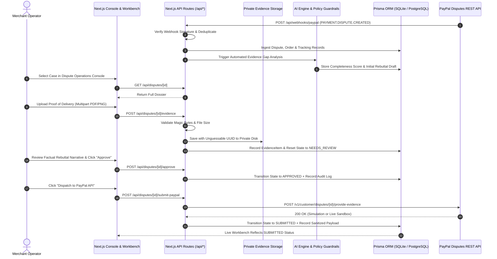

# AutoSettle AI

> **Autonomous PayPal Dispute Resolution & Evidence Orchestration Engine for Merchants**  
> *Built for the PayPal AI Hackathon 2026*

---

## 1. Executive Summary & Problem Solved

Online merchants face substantial operational challenges managing payment disputes across PayPal and card networks:
- **Strict Response Windows**: Claim response deadlines range between 24 and 48 hours. Missing a deadline results in automatic loss, forfeited merchandise, and non-refundable chargeback fees.
- **Scattered Proof**: Transaction metadata, warehouse fulfillment records, carrier tracking confirmations, and buyer communications are siloed across multiple systems (ERP, Shopify, UPS, Zendesk).
- **Suboptimal Rebuttals**: Manually typed rebuttals often omit required seller protection criteria (such as signature confirmations matching destination postal codes) or use unconstructive language.
- **Risk of LLM Hallucinations**: Generic AI tools risk hallucinating fake tracking numbers, scan dates, or unrealistic guarantee statements that breach dispute terms.

**AutoSettle AI** provides an autonomous, human-governed dispute resolution workbench that:
1. **Ingests disputes in real-time** via PayPal webhooks or manual intake.
2. **Aggregates evidence automatically** from order databases and carrier tracking endpoints.
3. **Identifies documentation gaps** using deterministic rule-based and AI analysis.
4. **Drafts factual rebuttal narratives** strictly citing verified records with zero hallucinations.
5. **Enforces human-in-the-loop merchant approval** before dispatching responses.
6. **Submits verified packages** directly to the **PayPal Customer Disputes REST API v1**.

---

## 2. Key Features

- **Merchant Operations Console**: High-performance prioritized dispute queue powered by AG Grid, sorting cases by urgency, response due date, and claim reason.
- **Dispute Workbench**: Comprehensive drawer detailing customer messages, linked order information, carrier tracking milestones, evidence locker, AI rebuttal draft, and submission audit trail.
- **Secure Multipart Evidence Locker**: Production-ready multipart file upload supporting PDF, PNG, and JPEG documents with strict magic byte validation, 10MB limits, UUID sanitization, and path traversal prevention.
- **Deterministic AI Reasoning Engine**: Analyzes dispute context against PayPal Seller Protection policies, calculates a 0–100% evidence completeness score, and flags critical gaps.
- **Anti-Hallucination Policy Guardrails**: Enforces zero fabrication of tracking numbers and rejects forbidden win guarantee claims.
- **Human-in-the-Loop Governance**: Requiring explicit merchant compliance approval before dispatching submissions to PayPal.
- **Dual PayPal Integration Mode**: Seamlessly toggles between live PayPal Sandbox REST API dispatch and high-fidelity simulation mode.
- **Tamper-Evident Audit Trail**: Automatically logs every webhook ingestion, evidence upload, AI analysis, human approval, and API dispatch with credential masking.
- **Top-Level Navigation Suite**:
  - `Payment Intelligence`: Transaction overview correlating gross payments, payment source, dispute exposure, and buyer identities.
  - `Analytics Dashboard`: Real-time dispute volume, win rate, workflow pipeline distribution, and velocity metrics.
  - `Webhook Lab`: Inbound PayPal webhook history, signature verification status, payload inspection, and interactive event simulation.
  - `Settings`: Merchant profile, operating mode switch (`DEMO` vs `SANDBOX`), write-only PayPal credentials management, and AI analysis toggles.

---

## 3. Architecture & Data Flow

### 3.1 End-to-End Workflow Diagram



### 3.2 Response Workflow State Machine

Disputes progress through distinct, audited lifecycle states:
```
[DRAFT] -> [NEEDS_REVIEW] -> [APPROVED] -> [SUBMITTING] -> [SUBMITTED]
                                      \                       /
                                       --> [SUBMISSION_FAILED]
```

---

## 4. Domain Data Model (11 Prisma Models)

The relational schema is defined in `prisma/schema.prisma`:

| Model | Description | Key Attributes |
|---|---|---|
| `Merchant` | Global merchant profile and operational settings | `id`, `businessName`, `supportEmail`, `mode`, `requireHumanApproval`, `strictEvidenceEnforced` |
| `PayPalConnection` | Sandbox/Production API credentials & status | `merchantId`, `environment`, `clientId`, `clientSecret` (masked), `status` |
| `Dispute` | Primary dispute record | `id`, `paypalDisputeId`, `status`, `reason`, `disputeAmount`, `responseDueDate`, `responseWorkflowStatus` |
| `Transaction` | Financial transaction tied to dispute | `sellerTransactionId`, `paypalTransactionId`, `grossAmount`, `paymentStatus`, `paymentSource` |
| `Order` | Merchant ERP order data | `orderNumber`, `orderDate`, `customerName`, `shippingAddress`, `itemsJson`, `orderTotal` |
| `TrackingInfo` | Carrier tracking details and signature proof | `carrier`, `trackingNumber`, `status`, `shippedDate`, `deliveredDate`, `destinationZip`, `signedBy` |
| `EvidenceItem` | Attached proof document in evidence locker | `disputeId`, `evidenceType`, `title`, `fileName`, `fileUrl`, `fileType`, `fileSize`, `strength` |
| `AiAnalysis` | AI reasoning, scores, and guardrails | `completenessScore`, `recommendedAction`, `recommendationRationale`, `keyStrengthsJson`, `criticalGapsJson` |
| `DraftResponse` | Versioned rebuttal for merchant review | `version`, `targetAction`, `rebuttalNarrative`, `characterCount`, `isApproved`, `approvedBy` |
| `SubmissionAttempt` | Immutable PayPal API dispatch log | `endpoint`, `httpStatusCode`, `status`, `requestPayloadSanitized`, `responsePayloadSanitized` |
| `WebhookEvent` | Ingested webhook record for deduplication | `paypalWebhookEventId`, `eventType`, `status`, `signatureVerified`, `payloadSanitized` |
| `AuditLogEntry` | Immutable chronological security audit trail | `eventType`, `severity`, `summary`, `detailsJson`, `actor`, `timestamp` |

---

## 5. Technology Stack

- **Framework**: Next.js 14.2 (App Router, React 18)
- **Language**: TypeScript 5.0 (Strict mode enabled)
- **Styling**: Tailwind CSS 3.4 & PostCSS
- **Database & ORM**: SQLite + Prisma ORM 5.22
- **Data Grid**: AG Grid Community 31.3
- **Icons**: Lucide React
- **Validation**: Zod 4.6
- **Test Runner**: Node.js Test Runner + `tsx` 4.23

---

## 6. Project Directory Structure

```
AutoSettle-AI/
├── prisma/
│   ├── schema.prisma               # 11-model relational domain schema
│   └── seed.ts                     # Seed script with 5 realistic scenarios
├── src/
│   ├── app/
│   │   ├── layout.tsx              # Root HTML shell & fonts
│   │   ├── page.tsx                # Main Dispute Operations Console
│   │   ├── payments/page.tsx       # Payment Intelligence dashboard
│   │   ├── analytics/page.tsx      # Analytics & workflow pipeline metrics
│   │   ├── webhooks/page.tsx       # Webhook Lab & event inspector
│   │   ├── settings/page.tsx       # Merchant settings & PayPal configuration
│   │   └── api/
│   │       ├── disputes/           # Dispute listing & manual intake
│   │       │   ├── [id]/
│   │       │   │   ├── analyze/    # Run AI gap analysis
│   │       │   │   ├── approve/    # Merchant approval gate
│   │       │   │   ├── evidence/   # Multipart upload & JSON evidence
│   │       │   │   │   └── [evidenceId]/ # Secure streaming retrieval & deletion
│   │       │   │   ├── fetch/      # Sync single dispute from PayPal
│   │       │   │   └── submit-paypal/ # Dispatch submission to PayPal
│   │       │   └── reset-seed/     # Restore database to 5 pristine scenarios
│   │       ├── intelligence/[id]/  # Timeline & operational signals
│   │       ├── settings/           # Settings GET/POST endpoints
│   │       ├── stats/              # Real-time dashboard KPI metrics
│   │       ├── webhook-events/     # Webhook event history list
│   │       └── webhooks/paypal/    # Webhook ingestion & deduplication
│   ├── components/
│   │   ├── Sidebar.tsx             # Collapsible navigation drawer
│   │   ├── NavigationHeader.tsx    # Header with search, status & quick actions
│   │   ├── DashboardStats.tsx      # Top metric cards & overview charts
│   │   ├── DisputeConsoleTable.tsx # AG Grid dispute table with custom cells
│   │   ├── DisputeWorkbench.tsx    # Deep-dive dispute drawer with tabs
│   │   ├── WebhookSimulatorModal.tsx # Interactive test webhook dispatcher
│   │   └── SettingsModal.tsx       # Quick modal settings dialog
│   ├── lib/
│   │   ├── ai-agent.ts             # Deterministic analysis & anti-hallucination engine
│   │   ├── ai-context.ts           # Dispute context builder
│   │   ├── audit.ts                # Audit logging & credential sanitizer
│   │   ├── courier.ts              # Courier provider interface & blueprints
│   │   ├── evidence-storage.ts     # Multipart disk storage & magic byte validation
│   │   ├── paypal-webhook.ts       # PayPal webhook signature verification
│   │   ├── paypal.ts               # PayPal REST Disputes client & simulator
│   │   ├── prisma.ts               # Prisma singleton client
│   │   └── types.ts                # TypeScript interfaces & Zod schemas
│   └── tests/
│       ├── dispute-workflow.test.ts # Unit tests (anti-hallucination, Zod, sanitization)
│       └── e2e-workflow.test.ts     # End-to-end integration test suite
├── storage/
│   └── evidence/                   # Private disk evidence storage (outside public/)
├── .env.example                    # Verified environment template
├── package.json                    # Scripts and dependencies
├── tailwind.config.ts              # Tailwind CSS configuration
└── tsconfig.json                   # TypeScript configuration
```

---

## 7. Installation & Setup

### 7.1 Prerequisites
- **Node.js**: `v18.17.0+` or `v20.x` or `v22.x`
- **npm**: `v9.x+` or `v10.x`
- **Git**

### 7.2 Installation Steps
```bash
# 1. Clone repository
git clone https://github.com/Tundeakinbami-dev/AutoSettle-AI.git
cd AutoSettle-AI

# 2. Install dependencies
npm install

# 3. Create environment configuration
cp .env.example .env

# 4. Initialize database schema
npx prisma db push

# 5. Populate pristine seed scenarios
npm run seed

# 6. Start development server
npm run dev
```

The application will be accessible at **http://localhost:3000**.

---

## 8. Environment Variables Reference

Every environment variable utilized by AutoSettle AI:

| Variable | Description | Required | Default in Demo |
|---|---|---|---|
| `DATABASE_URL` | SQLite or PostgreSQL connection string | Yes | `"file:./dev.db"` |
| `APP_MODE` | Operating mode: `"DEMO"` or `"SANDBOX"` | No | `"DEMO"` |
| `BASE_URL` | Base URL used for callbacks | No | `"http://localhost:3000"` |
| `PAYPAL_CLIENT_ID` | PayPal REST App Client ID | Only for live Sandbox | Empty (Simulator) |
| `PAYPAL_CLIENT_SECRET` | PayPal REST App Secret (write-only) | Only for live Sandbox | Empty (Simulator) |
| `PAYPAL_ENVIRONMENT` | PayPal environment: `"sandbox"` or `"live"` | No | `"sandbox"` |
| `PAYPAL_WEBHOOK_ID` | Registered Webhook ID in PayPal Dashboard | Only for live webhooks | Empty |
| `PAYPAL_WEBHOOK_SECRET` | Webhook verification secret | No | Empty |
| `AI_API_KEY` | Optional OpenAI/Gemini API key | No | Uses offline engine |
| `AI_MODEL` | AI model name (e.g. `gpt-4o`) | No | `"gpt-4o"` |
| `CARRIER_INTEGRATION_MODE`| Courier mode: `"SIMULATED"`, `"EASYPOST"`, `"UPS"` | No | `"SIMULATED"` |
| `EASYPOST_API_KEY` | EasyPost API key for live carrier tracking | Only for EasyPost | Empty |
| `UPS_CLIENT_ID` | Direct UPS Developer OAuth Client ID | Only for UPS | Empty |
| `UPS_CLIENT_SECRET` | Direct UPS Developer OAuth Secret | Only for UPS | Empty |
| `UPS_ENVIRONMENT` | UPS environment: `"sandbox"` or `"production"` | No | `"sandbox"` |

---

## 9. Development Commands

| Command | Action |
|---|---|
| `npm run dev` | Starts Next.js development server on port 3000 |
| `npm run build` | Compiles production build and validates types |
| `npm run start` | Starts production server from `.next` build |
| `npm run lint` | Runs ESLint validation across all code |
| `npm test` | Runs both unit tests and end-to-end integration tests |
| `npm run test:unit` | Runs dispute workflow, schema & compliance unit tests |
| `npm run test:e2e` | Runs full 11-step end-to-end integration test suite |
| `npm run seed` | Re-seeds database with baseline dispute scenarios |

---

## 10. API Documentation

### Dispute Endpoints
- `GET /api/disputes`: List disputes with search (`?search=`), status filter (`?status=`), and workflow filter (`?workflowStatus=`).
- `POST /api/disputes`: Create a dispute intake record.
- `GET /api/disputes/[id]`: Retrieve single dispute with linked order, tracking, evidence, messages, and audit logs.
- `POST /api/disputes/[id]/analyze`: Trigger AI gap analysis and generate a factual rebuttal draft.
- `POST /api/disputes/[id]/approve`: Merchant authorization gate approving draft for PayPal dispatch.
- `POST /api/disputes/[id]/submit-paypal`: Dispatch evidence or claim response to PayPal REST API (supports `simulateError: true`).
- `POST /api/disputes/reset-seed`: Reset database to pristine 5 demo scenarios.

### Evidence Endpoints
- `POST /api/disputes/[id]/evidence`:
  - **Multipart Upload** (`multipart/form-data`): Accepts `file` or `files` with fields `evidenceType`, `title`, `description`, `strength`. Validates magic bytes (PDF, PNG, JPEG) and max 10MB file size.
  - **JSON Mode** (`application/json`): Backward-compatible metadata attachment.
- `GET /api/disputes/[id]/evidence/[evidenceId]`: Securely streams file from private storage with `X-Content-Type-Options: nosniff` and CSP headers.
- `DELETE /api/disputes/[id]/evidence/[evidenceId]`: Deletes evidence record from DB and deletes file from disk.

### Webhook & Intelligence Endpoints
- `POST /api/webhooks/paypal`: Ingests incoming PayPal webhooks (`PAYMENT.DISPUTE.CREATED`, `UPDATED`, `RESOLVED`) with signature verification and deduplication.
- `GET /api/webhook-events`: Paginated webhook event history (`?limit=`, `?offset=`, `?eventType=`).
- `GET /api/intelligence/[id]`: Unified transaction timeline and dispute signals.
- `GET /api/stats`: Real-time dashboard KPI metrics and workflow counts.
- `GET /api/settings` & `POST /api/settings`: Read and update merchant configuration.

---

## 11. Secure Evidence Storage Architecture

Evidence files are stored according to strict security standards:
- **Private Directory**: Files are placed in `./storage/evidence/` (completely outside `public/`). Files cannot be accessed directly via static URLs.
- **Magic Byte Verification**: Rather than trusting file extensions or client headers, file contents are validated by checking their initial byte signatures:
  - PDF: `%PDF-` (`0x25 0x50 0x44 0x46`)
  - PNG: `0x89 0x50 0x4E 0x47 0x0D 0x0A 0x1A 0x0A`
  - JPEG: `0xFF 0xD8 0xFF`
- **Path Traversal Prevention**: File names are sanitized and assigned random UUIDs (`crypto.randomUUID()`). Any request containing `..`, `/`, or `\` is blocked.
- **Authorized Streaming**: Documents are served strictly via `GET /api/disputes/[id]/evidence/[evidenceId]`, which validates dispute ownership and applies `Content-Security-Policy: default-src 'none'`.

---

## 12. Courier Provider Integration

AutoSettle AI provides a carrier abstraction defined in `src/lib/courier.ts`:

### 12.1 Simulated Provider (Default)
`SimulatedCourierProvider` requires zero external credentials. It generates reproducible tracking data based on the tracking number hash, returning carrier status, delivery dates, and electronic recipient signatures (e.g. `"S. CHEN"`).

### 12.2 Production Blueprints
When production credentials become available, the factory `getCourierProvider()` automatically switches implementations:
- **EasyPost Provider** (`CARRIER_INTEGRATION_MODE="EASYPOST"`): Uses `EASYPOST_API_KEY` to query `https://api.easypost.com/v2/trackers` for unified UPS, FedEx, and USPS tracking.
- **Direct UPS REST API Provider** (`CARRIER_INTEGRATION_MODE="UPS"`): Obtains OAuth2 tokens from `https://onlinetools.ups.com/security/v1/oauth/token` using `UPS_CLIENT_ID` and `UPS_CLIENT_SECRET`, then queries `/api/track/v1/details/{inquiryNumber}`.

---

## 13. PayPal Sandbox Setup & Testing

### 13.1 Sandbox Verification
1. Create a PayPal Developer Account at [developer.paypal.com](https://developer.paypal.com/).
2. Navigate to **Apps & Credentials** and select **Sandbox**.
3. Create a REST API app and enable **Customer Disputes**.
4. In the AutoSettle AI UI, navigate to **Settings** (or edit `.env`), enter your **Client ID** and **Client Secret**, and set operating mode to **Sandbox**.
5. Live disputes created in Sandbox can be synced via `GET /api/disputes/[id]/fetch` and submitted directly via `POST /api/disputes/[id]/submit-paypal`.

### 13.2 Webhook Tunnel Setup
To receive live PayPal Sandbox webhooks on localhost:
```bash
# Expose port 3000
npx ngrok http 3000
```
Register the URL `https://<your-ngrok-subdomain>.ngrok-free.app/api/webhooks/paypal` in the PayPal Developer Dashboard under your sandbox app's Webhooks section.

---

## 14. Testing & Verification

The test suite validates both unit-level logic and complete end-to-end workflows:

```bash
npm test
```

### 14.1 Unit Tests (`src/tests/dispute-workflow.test.ts`)
- Evaluates Item Not Received (INR) defense with carrier proof of delivery.
- Flags critical documentation gaps when tracking is absent.
- Recommends partial refund strategy for SNAD disputes lacking pre-pack photos.
- Anti-hallucination compliance checking rejecting forbidden guarantee language.
- Zod schema validation on AI reasoning payloads.
- Sensitive credential sanitization in audit logs.
- Workflow state machine transitions.
- PayPal Disputes client simulation operations.

### 14.2 End-to-End Integration Tests (`src/tests/e2e-workflow.test.ts`)
- **Step 1**: Seeds isolated test merchant and dispute dossier.
- **Step 2**: Validates and writes multipart PDF evidence with genuine magic bytes to private disk storage.
- **Step 3**: Ingests incoming simulated webhook and validates event deduplication.
- **Step 4**: Runs deterministic AI dispute analysis and validates zero-hallucination compliance.
- **Step 5**: Creates unapproved draft rebuttal and enforces merchant authorization gate transition.
- **Step 6**: Calls PayPal client in simulated mode, verifying transition to `SUBMITTED`.
- **Negative Tests**: Validates rejection of corrupted magic bytes, oversized files, path traversal attempts, missing evidence critical gaps, and simulation failure toggles.

---

## 15. Known Limitations

The following items are identified as ongoing production considerations:

1. **Chargeback Trends Time-Series API**: The Analytics dashboard displays live dispute counts and pipeline status from the database. A dedicated `/api/analytics/trends` endpoint with date-bucketed historical aggregation is not yet present; no fabricated historical trend data is rendered.
2. **Notification Delivery Service**: Automated dispute deadline email notifications require an external provider (e.g. SendGrid, Resend). The system currently surfaces in-app urgency badges and `<48h` deadline countdowns.
3. **Multi-Tenant User Authentication**: The application currently manages a single merchant profile (`default_merchant`). Full role-based multi-tenant authentication (e.g. Clerk / NextAuth) is slated for future release.

---

## 16. Security & Privacy Safeguards

- **No Cleartext Credentials in Logs**: Bearer tokens, PayPal client secrets, and sensitive authentication headers are automatically masked by `sanitizeData()` before audit trail persistence.
- **Write-Only Secrets in UI**: The Settings page accepts new PayPal secrets but never returns existing secrets in GET API responses.
- **No Public Evidence Links**: Evidence documents are inaccessible via direct static URLs and are served strictly through authorized streaming endpoints.
- **Input Sanitization**: Database queries are parameterized through Prisma ORM, preventing SQL injection vulnerabilities.

---

## 17. License

This project is licensed under the **MIT License**. See the [LICENSE](LICENSE) file for details.
