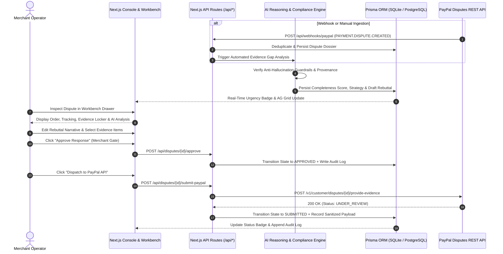
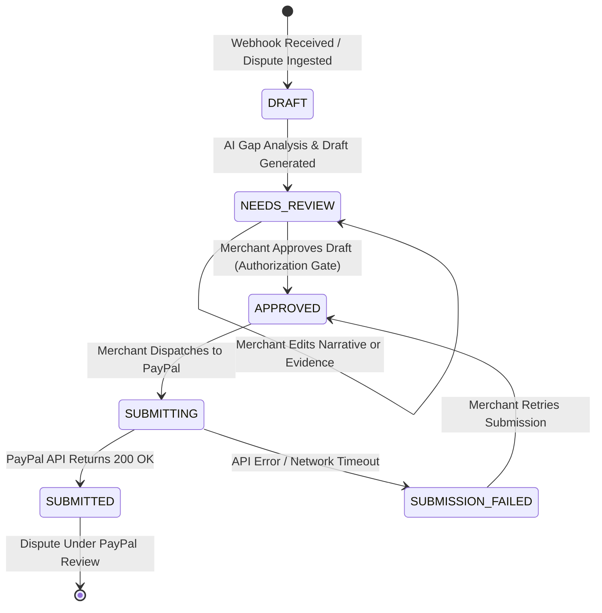

# AutoSettle AI ⚡

> **Autonomous PayPal Dispute Resolution & Evidence Orchestration for Online Merchants**  
> *Built for the PayPal AI Hackathon 2026*

[](https://nextjs.org/)
[](https://www.typescriptlang.org/)
[](https://tailwindcss.com/)
[](https://www.prisma.io/)
[](https://developer.paypal.com/docs/api/customer-disputes/v1/)
[](https://www.ag-grid.com/)
[](LICENSE)

---

## 📖 Executive Summary

PayPal disputes are time-critical, high-stress events for online merchants. When a customer files a dispute (such as **Item Not Received (INR)**, **Significantly Not As Described (SNAD)**, or **Unauthorised Transaction**), merchants face strict deadlines (often under 24–48 hours) to furnish verifiable evidence. Missing a deadline or submitting weak, disorganized proof results in default forfeiture, lost inventory, and costly dispute processing fees.

**AutoSettle AI** turns manual dispute response workflows into an intelligent, streamlined process that takes **minutes rather than hours**:

1. **Automated Ingestion**: Ingests PayPal disputes in real-time via webhooks (`PAYMENT.DISPUTE.*`) or manual synchronization.
2. **Evidence Locker Aggregation**: Correlates order records, carrier fulfillment milestones, customer chat history, and store return policies into a unified case dossier.
3. **AI Evidence Gap Detection**: Scores evidence completeness (0–100%), highlights missing critical documentation (e.g., pre-shipment photos or delivery signatures), and determines the optimal dispute strategy (`PROVIDE_EVIDENCE`, `OFFER_PARTIAL_REFUND`, or `ACCEPT_CLAIM`).
4. **Anti-Hallucination Rebuttal Drafting**: Generates professional, strictly factual response narratives referencing verifiable provenance sources, with strict guardrails preventing fabricated tracking numbers or forbidden win guarantees.
5. **Human-in-the-Loop Authorization Gate**: Requires explicit merchant review and compliance confirmation before any payload is dispatched to PayPal.
6. **Native PayPal REST API Dispatch**: Submits responses directly to the official PayPal Customer Disputes v1 API or evaluates them in zero-setup simulation mode.

---

## 🏆 Key Features & Differentiators

### 1. 🛡️ Strict Anti-Hallucination Guardrails & Provenance Tracking
AutoSettle AI enforces deterministic policy checks on every AI-generated response before allowing merchant approval:
- **Zero Evidence Fabrication**: The AI never invents tracking IDs, carrier scan dates, or buyer correspondence.
- **Factual Citation Provenance**: Every factual statement in the rebuttal is bound to a verified source (`"Carrier API"`, `"Shopify Order #10029"`, or `"Customer Ticket #819"`).
- **Delivery Status Fidelity**: Rebuttals never assert an order was delivered unless carrier tracking explicitly reports `DELIVERED`.
- **Forbidden Guarantee Enforcement**: Rebuttals strictly reject language promising guaranteed dispute wins, maintaining neutral, objective statements tailored for PayPal review officers.

### 2. ⚡ Real-Time Urgency & Deadline Management
- Visual countdown timers with color-coded urgency alerts:
  - 🚨 **Critical Alert (`< 24h`)**: Pulsing red badge highlighting disputes at immediate risk of default loss.
  - ⚠️ **Urgent Warning (`< 48h`)**: Amber indicator prioritizing queue response order.
- Urgency-sorted operations queue powered by **AG Grid** with quick-filtering by status, lifecycle stage, and claim reason.

### 3. 📦 Evidence Locker & Dynamic Strategy Engine
- Automatically aggregates supporting documentation into an organized digital locker:
  - **Proof of Delivery (POD)**: Carrier scan history, recipient signature proof, destination postal code match.
  - **Proof of Fulfillment**: Warehouse packing slips, pick-pack timestamp records, tracking numbers.
  - **Terms & Policies**: Published return and cancellation policies, customer agreement confirmations.
- Evaluates document strength (`STRONG`, `MODERATE`, `WEAK`) and calculates an overall **Evidence Completeness Score** (0–100%).
- Recommends the optimal dispute strategy:
  - `PROVIDE_EVIDENCE`: Formulates merchant defense when PayPal Seller Protection criteria are satisfied.
  - `OFFER_PARTIAL_REFUND`: Formulates a negotiated settlement when documentation has gaps (e.g., SNAD claims lacking pre-pack photos).
  - `ACCEPT_CLAIM`: Advises claim acceptance when defense documentation is insufficient, saving merchant fees and administrative time.

### 4. 🔗 Native PayPal Customer Disputes REST API Integration
Fully integrates with the official PayPal Customer Disputes REST API v1:
- `POST /v1/oauth2/token`: Client credentials grant for secure OAuth2 access tokens.
- `GET /v1/customer/disputes`: Dispute listing and synchronization.
- `GET /v1/customer/disputes/{id}`: Retrieval of complete dispute details from PayPal.
- `POST /v1/customer/disputes/{id}/provide-evidence`: Direct evidence and rebuttal submission.
- `POST /v1/customer/disputes/{id}/accept-claim`: 1-click claim acceptance.
- `POST /v1/customer/disputes/{id}/make-offer`: Settlement proposal creation.
- `POST /v1/customer/disputes/{id}/appeal`: Submission of appeals for closed cases.
- `POST /api/webhooks/paypal`: Real-time ingestion of PayPal webhook events (`PAYMENT.DISPUTE.CREATED`, `PAYMENT.DISPUTE.UPDATED`, `PAYMENT.DISPUTE.RESOLVED`) with signature verification and deduplication.
- **Dual Mode (Sandbox & Simulation)**: Switch seamlessly between live PayPal Sandbox credentials and a high-fidelity simulation mode with zero setup required.

### 5. ✍️ Human-in-the-Loop Merchant Authorization Gate
- **Merchant Approval Requirement**: Enabled by default to ensure no automated action is taken without merchant oversight.
- **Interactive Rebuttal Editor**: Merchants can review, edit, and fine-tune AI-drafted rebuttal narratives and adjust settlement amounts.
- **Evidence Selector**: Checkbox selection allows merchants to choose precisely which evidence items are attached to the API submission.

### 6. 📜 Tamper-Evident Immutable Audit Trail
- Logs every event, webhook arrival, AI gap analysis, merchant edit, approval action, and PayPal API dispatch.
- **Automatic Credential Sanitization**: Bearer tokens, client secrets, and sensitive authentication headers are automatically stripped and masked before persistence.

### 7. 📊 Executive Merchant Dashboard & Analytics
- Metric cards with trend indicators and sparklines:
  - Total Disputes & Active Cases
  - Critical Deadlines (`< 24h` / `< 48h`)
  - Total Revenue at Risk & Revenue Defended
  - Won & Settled Success Rates
  - Average Evidence Completeness Score
- Revenue Defense monthly area chart and dispute reason distribution breakdown.

### 8. 🧪 Interactive Webhook & Dispute Simulator
- Test automated dispute ingestion directly from the UI using the built-in **Webhook Simulator**.
- 1-click **Reset Demo Data** button to return the SQLite database to the 5 baseline scenarios at any time.

---

## 🏗️ Architecture & Workflow

### End-to-End Dispute Resolution Workflow



### Dispute Response Workflow Lifecycle



---

## 🗄️ Domain Data Model (11 Prisma Models)

The persistence layer is modeled with strict relational integrity using **Prisma ORM**:

| Model | Purpose | Key Attributes |
|---|---|---|
| `Merchant` | Global merchant profile & security policies | `requireHumanApproval`, `strictEvidenceEnforced`, `autoAnalyzeOnArrival` |
| `PayPalConnection` | Sandbox credentials & connection status | `environment`, `clientId`, `clientSecret` (masked), `status` |
| `Dispute` | Primary dispute case record | `paypalDisputeId`, `status`, `disputeLifeCycleStage`, `reason`, `responseWorkflowStatus`, `responseDueDate` |
| `Transaction` | Linked financial transaction | `sellerTransactionId`, `grossAmount`, `netAmount`, `feeAmount`, `paymentStatus` |
| `Order` | Merchant ERP order data | `orderNumber`, `orderDate`, `itemsJson`, `fulfillmentStatus`, `shippingAddress` |
| `TrackingInfo` | Carrier tracking & proof of delivery | `carrier`, `trackingNumber`, `status`, `deliveredDate`, `signedBy`, `checkpointHistory` |
| `CustomerMessage` | Customer correspondence thread | `sender`, `channel`, `timestamp`, `messageText`, `sentiment` |
| `EvidenceItem` | Digital evidence locker item | `evidenceType`, `title`, `description`, `strength`, `verified`, `provenanceSource` |
| `AiAnalysis` | AI reasoning, scores, and guardrails | `completenessScore`, `recommendedAction`, `recommendationRationale`, `keyStrengthsJson`, `criticalGapsJson`, `citationsJson` |
| `DraftResponse` | Versioned rebuttal for merchant review | `version`, `targetAction`, `rebuttalNarrative`, `characterCount`, `isApproved`, `approvedBy` |
| `SubmissionAttempt` | Immutable API dispatch log | `endpoint`, `httpStatusCode`, `requestPayloadSanitized`, `responsePayloadSanitized`, `status` |
| `WebhookEvent` | Webhook deduplication and audit | `paypalWebhookEventId`, `eventType`, `signatureVerified`, `payloadSanitized` |
| `AuditLogEntry` | Chronological audit trail | `eventType`, `severity`, `summary`, `detailsJson`, `actor`, `timestamp` |

---

## 🧪 Preloaded Demo Scenarios

The repository includes 5 realistic seed scenarios covering the primary dispute categories and edge cases:

```
┌─────────────┬───────────────────────────────────────┬────────────┬──────────────┬────────────────────────────┐
│ Dispute ID  │ Reason                                │ Amount     │ Urgency      │ AI Strategy & Highlight    │
├─────────────┼───────────────────────────────────────┼────────────┼──────────────┼────────────────────────────┤
│ PP-D-91042  │ Item Not Received (INR)               │ $289.50    │ 5 days left  │ PROVIDE_EVIDENCE           │
│             │                                       │            │              │ Verified UPS POD signature │
├─────────────┼───────────────────────────────────────┼────────────┼──────────────┼────────────────────────────┤
│ PP-D-83910  │ Not As Described (SNAD)               │ $440.00    │ 6 days left  │ OFFER_PARTIAL_REFUND       │
│             │                                       │            │              │ Pre-pack photo gap flagged │
├─────────────┼───────────────────────────────────────┼────────────┼──────────────┼────────────────────────────┤
│ PP-D-61023  │ Item Not Received (INR)               │ $125.00    │ < 3 HOURS    │ PROVIDE_EVIDENCE           │
│             │                                       │            │ CRITICAL 🚨  │ Fast 1-click submission    │
├─────────────┼───────────────────────────────────────┼────────────┼──────────────┼────────────────────────────┤
│ PP-D-72149  │ Unauthorised Transaction              │ $549.00    │ 8 days left  │ PROVIDE_EVIDENCE           │
│             │                                       │            │              │ Seller Protection met      │
├─────────────┼───────────────────────────────────────┼────────────┼──────────────┼────────────────────────────┤
│ PP-D-50218  │ Item Not Received (Resolved / Won)    │ $99.00     │ Resolved     │ HISTORICAL RECORD          │
│             │                                       │            │              │ Complete submission audit  │
└─────────────┴───────────────────────────────────────┴────────────┴──────────────┴────────────────────────────┘
```

---

## 💻 Technology Stack

| Layer | Technology | Description |
|---|---|---|
| **Frontend Framework** | [Next.js 14](https://nextjs.org/) (App Router, React 18) | Server-side and client-side rendering with TypeScript |
| **Styling & Design System** | [Tailwind CSS](https://tailwindcss.com/) | Modern slate luxury theme, responsive layouts, glassmorphism |
| **Typography** | Plus Jakarta Sans (`next/font/google`) | Clean, modern typography designed for fintech applications |
| **Data Grid** | [AG Grid Community 31.3](https://www.ag-grid.com/) | High-performance merchant operations grid with custom cell renderers |
| **Icons** | [Lucide React](https://lucide.dev/) | Consistent, lightweight vector iconography |
| **Database & ORM** | [Prisma 5.22](https://www.prisma.io/) + SQLite | Zero-dependency local setup, seamlessly portable to PostgreSQL |
| **AI Reasoning Engine** | Structured Output + Zod Schema Validation | OpenAI / Gemini via OpenAI-compatible endpoint with automatic deterministic fallback |
| **Payments Integration** | PayPal Customer Disputes REST API v1 | Official OAuth2 bearer auth, `/provide-evidence`, `/accept-claim`, `/make-offer` |
| **Date Utilities** | [date-fns 4.4](https://date-fns.org/) | Precise deadline calculations and countdown timestamps |
| **Testing** | Node.js Test Runner + `ts-node` | Native automated test runner verifying compliance, schemas, and API clients |

---

## 🚀 Getting Started

### 1. Prerequisites
- **Node.js**: `v18.17.0+` or `v20.x`
- **npm**: `v9.x+` or `v10.x`
- **Git**

### 2. Clone & Install
```bash
git clone https://github.com/Tundeakinbami-dev/AutoSettle-AI.git
cd AutoSettle-AI
npm install
```

### 3. Environment Configuration
Create a `.env` file in the root directory:
```bash
cp .env.example .env
```

Configure your environment variables:
```env
# Database Connection (SQLite local file)
DATABASE_URL="file:./dev.db"

# PayPal Developer Sandbox (Optional - system defaults to Simulation Mode if omitted)
PAYPAL_CLIENT_ID="YOUR_PAYPAL_SANDBOX_CLIENT_ID"
PAYPAL_CLIENT_SECRET="YOUR_PAYPAL_SANDBOX_CLIENT_SECRET"
PAYPAL_ENVIRONMENT="sandbox"
PAYPAL_WEBHOOK_ID="YOUR_PAYPAL_WEBHOOK_ID"

# AI Provider Configuration (Optional - offline factual engine runs if omitted)
AI_API_KEY="YOUR_API_KEY"
AI_MODEL="gpt-4o"

# Application Base URL
BASE_URL="http://localhost:3000"

# Application Mode: DEMO (synthetic data) or SANDBOX (live PayPal Sandbox)
APP_MODE="DEMO"
```

> [!NOTE]
> **Zero-Setup Evaluation**: AutoSettle AI is fully functional out of the box without external API keys. If PayPal credentials or AI keys are omitted, the application uses high-fidelity PayPal REST API simulation and its deterministic factual analysis engine.

### 4. Database Setup & Seeding
Initialize the SQLite database schema and seed the 5 realistic dispute scenarios:
```bash
npx prisma db push
npm run seed
```

### 5. Run the Application
Start the development server:
```bash
npm run dev
```
Open **[http://localhost:3000](http://localhost:3000)** in your browser.

To create an optimized production build:
```bash
npm run build
npm run start
```

---

## 🧪 Running Automated Tests

AutoSettle AI includes a test suite verifying anti-hallucination guardrails, schema validity, and API client behavior:

```bash
npm test
```

### Test Coverage Highlights:
- ✅ **INR Defense Evaluation**: Validates identification of carrier proof and signature confirmation.
- ✅ **Critical Evidence Gap Detection**: Flags missing carrier scans for INR claims and recommends `ACCEPT_CLAIM`.
- ✅ **SNAD Settlement Strategy**: Detects missing warehouse pre-pack photos and recommends `OFFER_PARTIAL_REFUND`.
- ✅ **Anti-Hallucination Compliance Guardrail**: Rejects forbidden win guarantee phrases and prevents delivery claims when carrier status is not `DELIVERED`.
- ✅ **Zod Schema Validation**: Enforces strict typing on all AI analysis and rebuttal outputs.
- ✅ **Sensitive Credential Sanitization**: Verifies that tokens, client secrets, and authorization headers are never logged to the audit trail.
- ✅ **Response Workflow State Machine**: Validates transitions (`DRAFT` → `NEEDS_REVIEW` → `APPROVED` → `SUBMITTING` → `SUBMITTED` / `SUBMISSION_FAILED`).
- ✅ **PayPal Disputes API Client Simulation**: Validates payload formulation and simulated API responses.

---

## ⚙️ PayPal Sandbox & Webhook Setup

To connect live PayPal Sandbox credentials:

1. Log in to the [PayPal Developer Dashboard](https://developer.paypal.com/).
2. Navigate to **Apps & Credentials** and select **Sandbox**.
3. Create a REST API app and ensure the **Customer Disputes** product is enabled.
4. Copy the **Client ID** and **Secret** into your `.env` file or paste them directly into the **Settings Modal** in the UI.
5. To test incoming webhooks locally:
   - Expose port `3000` via a tunnel tool such as [Cloudflare Tunnel](https://developers.cloudflare.com/cloudflare-one/connections/connect-networks/) or [ngrok](https://ngrok.com/):
     ```bash
     ngrok http 3000
     ```
   - In your PayPal Developer Dashboard, configure a webhook pointing to:
     ```
     https://<your-tunnel-url>/api/webhooks/paypal
     ```
   - Subscribe to dispute events:
     - `PAYMENT.DISPUTE.CREATED`
     - `PAYMENT.DISPUTE.UPDATED`
     - `PAYMENT.DISPUTE.RESOLVED`
   - Copy the generated **Webhook ID** into `PAYPAL_WEBHOOK_ID` in your `.env`.

---

## 🔌 API Endpoint Reference

| Method | Endpoint | Description |
|---|---|---|
| `GET` | `/api/disputes` | List all disputes with search, status filters, and relations |
| `POST` | `/api/disputes` | Manually record a new dispute case |
| `GET` | `/api/disputes/[id]` | Fetch complete dispute dossier, linked order, tracking, evidence, and audit logs |
| `POST` | `/api/disputes/[id]/analyze` | Trigger AI gap analysis, completeness scoring, and draft rebuttal generation |
| `POST` | `/api/disputes/[id]/approve` | Merchant authorization gate to approve response for PayPal dispatch |
| `POST` | `/api/disputes/[id]/submit-paypal` | Dispatch approved response to PayPal Disputes REST API |
| `POST` | `/api/disputes/[id]/evidence` | Attach a new verified document to the evidence locker |
| `POST` | `/api/disputes/reset-seed` | Reset database back to pristine 5-case seed dataset |
| `GET` | `/api/stats` | Retrieve aggregate metrics, urgency alerts, win rate, and revenue charts |
| `GET` | `/api/settings` | Get merchant profile and connection configuration |
| `POST` | `/api/settings` | Update merchant settings and PayPal sandbox credentials |
| `POST` | `/api/webhooks/paypal` | Ingest and process PayPal dispute webhooks with deduplication |

---

## 🚢 Production Deployment

### Deploying to Render / Vercel

1. Push your repository to GitHub.
2. Link the repository to **Render** or **Vercel**.
3. Configure the build parameters:
   - **Build Command**: `npm install && npx prisma db push && npm run seed && npm run build`
   - **Start Command**: `npm run start`
4. Set Environment Variables:
   - `DATABASE_URL`: Connection string (SQLite file path or PostgreSQL database URL)
   - `PAYPAL_CLIENT_ID`: PayPal Sandbox or Live client ID
   - `PAYPAL_CLIENT_SECRET`: PayPal Sandbox or Live secret
   - `PAYPAL_ENVIRONMENT`: `sandbox` or `live`
   - `APP_MODE`: `SANDBOX` for live API interaction, or `DEMO` for synthetic demonstration
   - `AI_API_KEY`: API key for OpenAI or Gemini (optional)

---

## ⚖️ Hackathon Compliance & Ethical AI Declaration

AutoSettle AI was engineered specifically for the **PayPal AI Hackathon 2026** and adheres strictly to PayPal Developer Guidelines and Disputes Policies:

1. **No Evidence Fabrication**: AutoSettle AI strictly prohibits the generation of synthetic or fabricated delivery scans, invoices, or customer statements. Every submitted claim must trace back to a verifiable merchant or carrier source.
2. **Merchant Authorization Mandate**: Automated AI actions require explicit merchant review and authorization prior to submission.
3. **Transparent Operational Modes**: When operating in demonstration mode, the UI clearly displays a **"Demo Data"** banner to ensure complete transparency.
4. **Data Privacy & Credential Security**: Credentials and authorization tokens are strictly masked and excluded from persistent audit logs.

---

## 📄 License

This project is licensed under the **MIT License**. See [LICENSE](LICENSE) for details.
